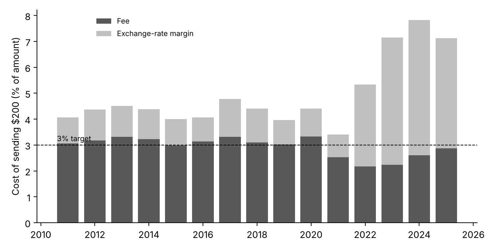
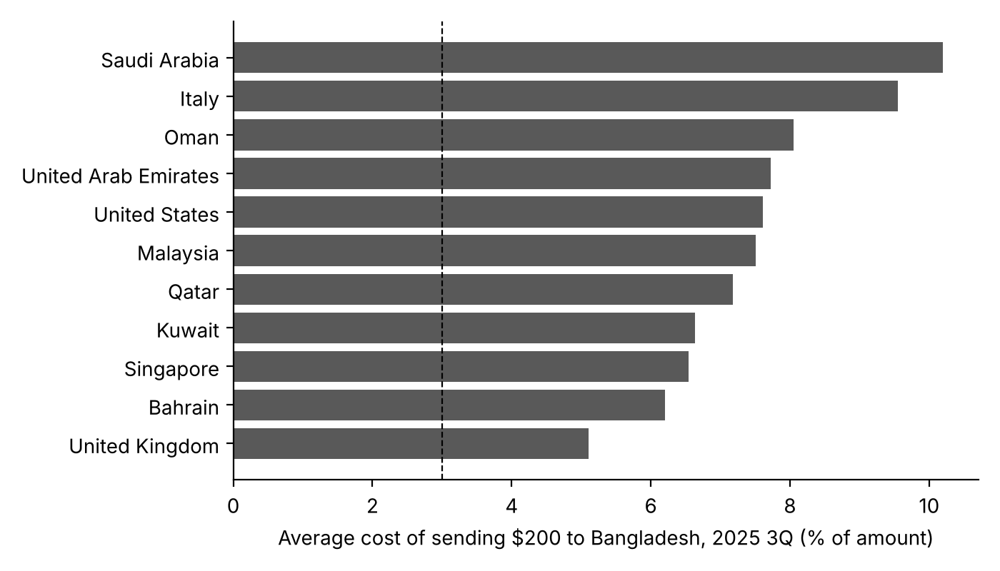

# remittance-cost-monitor

What it costs a migrant worker to send money home to Bangladesh, route by route, 2011 to 2025.

## What this project does

Millions of Bangladeshis work abroad and send part of their wages home. Every transfer passes through a bank or money-transfer company, which charges a fee and usually gives a worse exchange rate than the market rate. That gap is the last middleman between a worker's pay and their family.

The World Bank's **Remittance Prices Worldwide** survey records these prices every quarter: for each sending country, it checks what each provider charges to send the equivalent of 200 and 500 US dollars. This project extracts every surveyed service for sending money **to Bangladesh**, checks the data, and shows how the cost has changed, which routes and providers are cheapest, and how far Bangladesh is from the international target of **3 percent** (UN Sustainable Development Goal 10.c).

- **7,615 price quotes**, 2011 Q1 to 2025 Q3
- **13 sending countries**: Saudi Arabia, the United Arab Emirates, Qatar, Kuwait, Oman, Bahrain, Malaysia, Singapore, the United Kingdom, Italy, the United States, India and Pakistan (not every country is surveyed in every quarter)

## What it shows



- **Sending money home got much more expensive after 2021.** The average cost of sending $200 was between 4.0 and 4.8 percent every year from 2011 to 2020 and 3.4 percent in 2021. It rose to 5.3 percent in 2022, 7.2 percent in 2023 and 7.8 percent in 2024, and was 7.1 percent in the first three quarters of 2025.
- **The rise came from the exchange rate, not the fee.** Fees stayed between about 2 and 3.3 percent of the amount sent throughout. The exchange-rate margin (how much worse the provider's rate is than the market rate) was about 1 percent until 2021, then jumped to between 3 and 5 percent from 2022.
- **Almost no service meets the 3 percent target now.** About half of all quoted services cost less than 3 percent in 2019 to 2021; in 2025 only 3.5 percent did.
- **Saudi Arabia is the most expensive route.** In 2025 Q3, sending $200 from Saudi Arabia cost 10.2 percent on average, about $20. The United Kingdom was the cheapest at 5.1 percent.
- **Banks cost far more than money-transfer companies.** Over the last four quarters, banks averaged 12.2 percent and money-transfer companies 5.8 percent.
- **Sending more at once is cheaper.** Sending $500 cost about 1 to 2 percentage points less than sending $200, mainly because many fees are fixed.



Full tables, including every route in every quarter, are in [`output/tables/`](output/tables/).

## Things to know before using the numbers

- **Averages are simple averages** across the services surveyed on a route in a quarter, the World Bank's own method for a route. They are not weighted by how much money each provider actually carries, so they show what a worker would pay on average if they picked a surveyed provider, not what workers actually paid in total.
- **Quotes, not transactions.** The survey records the advertised price for a given amount on a given day.
- **2025 covers three quarters only** (Q1 to Q3), the latest data the World Bank has published.
- **The market rate behind the exchange-rate margin.** In 2025 Q3 the World Bank measured the margin on Bangladesh routes against an alternative interbank rate taken from the *Daily Observer* newspaper, as noted on those rows, rather than its usual source. The survey itself does not explain the rise in margins from 2022, so this project does not either.
- **Flagged rows.** 70 rows are kept as published but flagged in the `note_check` column: one has a surveyed amount printed as 6 instead of 200 US dollars (its other numbers are consistent with $200), and the rest have a negative total cost (the provider's exchange rate was better than the benchmark rate).
- **Firm types are as published**, including the two spellings "Post office" and "Post Office".

## How the data were checked

Run by [`code/02_clean.py`](code/02_clean.py).

1. **Against the World Bank's own report:** the global average recomputed from the downloaded file for 2025 Q3 is 6.36 percent, the figure in the World Bank's September 2025 report (Issue 54).
2. **Inside every row:** total cost equals the fee as a share of the amount plus the exchange-rate margin, to within 0.012 percentage points (rounding) for all 7,615 rows.
3. **No duplicates:** each service appears once per quarter.

## The data

[`data/clean/bangladesh_services.csv`](data/clean/bangladesh_services.csv): one row per service per sending country per quarter, with the provider, its type, the fee, exchange-rate margin and total cost for $200 and $500, and the survey date. Column definitions are in [`data/README.md`](data/README.md).

## What is here

| Folder or file | Contents |
|---|---|
| `data/clean/` | The Bangladesh dataset |
| `data/README.md` | Source, licence and column definitions |
| `code/` | Numbered scripts, run in order |
| `output/tables/` | Summary tables |
| `figures/` | The two charts above |

The World Bank's complete file (about 50 MB) is not kept here because of its size; `code/01_download.py` downloads it.

## Reproduce it

Needs Python 3.13 and the package versions pinned in `requirements.txt`.

```
pip install -r requirements.txt
python code/01_download.py    # World Bank complete dataset
python code/02_clean.py       # Bangladesh extract and checks
python code/03_tables.py      # tables and charts
```

## Licences

Code: MIT (see [`LICENSE`](LICENSE)). Data: World Bank, Remittance Prices Worldwide, licensed under Creative Commons Attribution 4.0 (CC BY 4.0); the Bangladesh extract here keeps that licence.

## Cite

Azom, Kazi Affnann (2026). *remittance-cost-monitor: The cost of sending money to Bangladesh, 2011-2025*. GitHub. https://github.com/Affnann/remittance-cost-monitor

See also [`CITATION.cff`](CITATION.cff).
